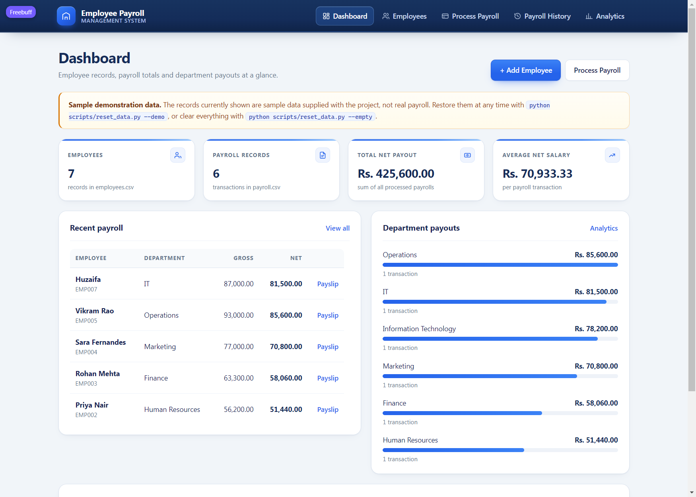
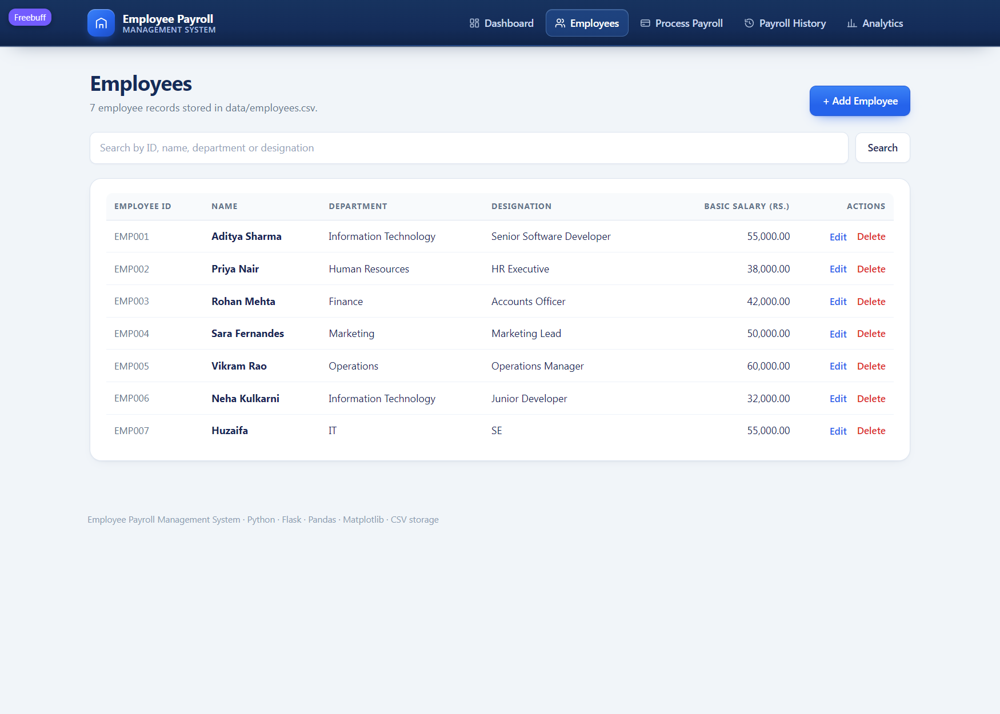
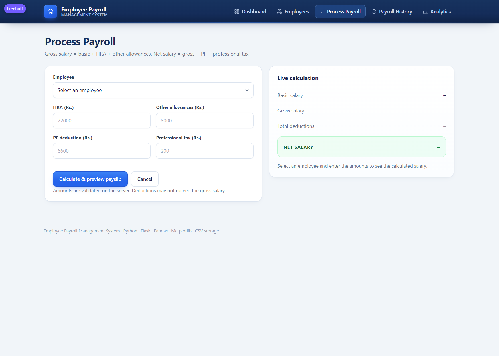
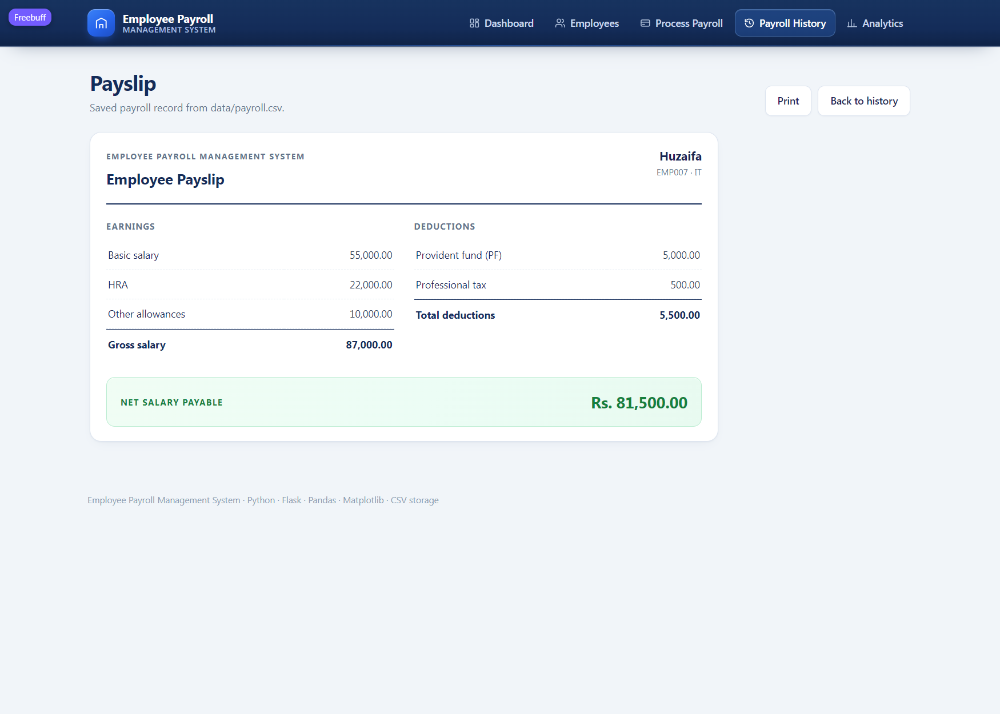
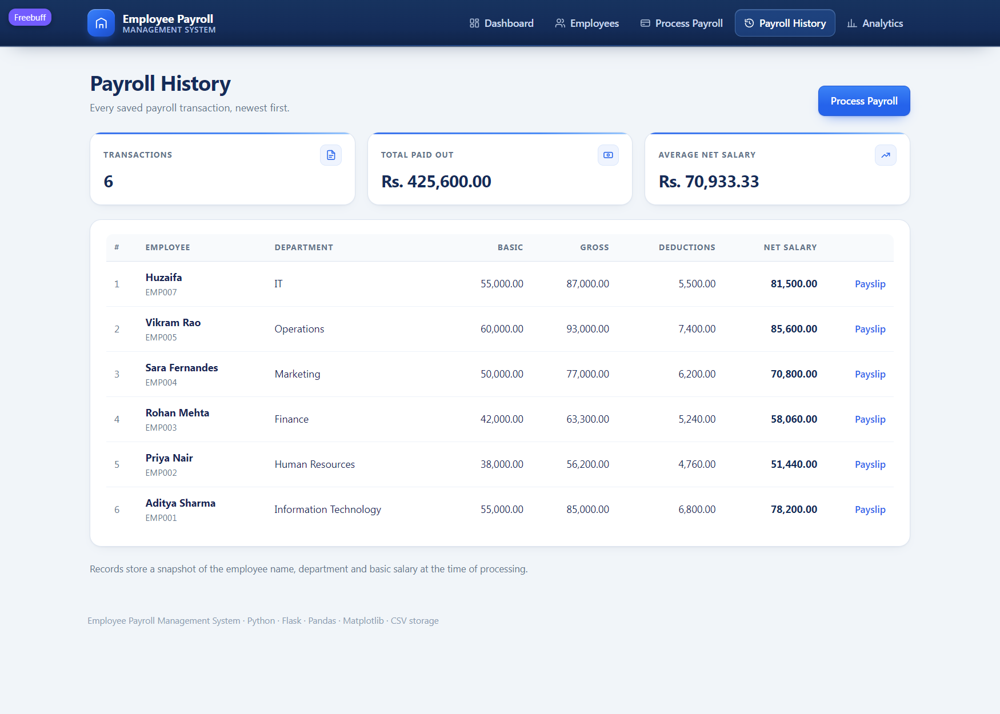
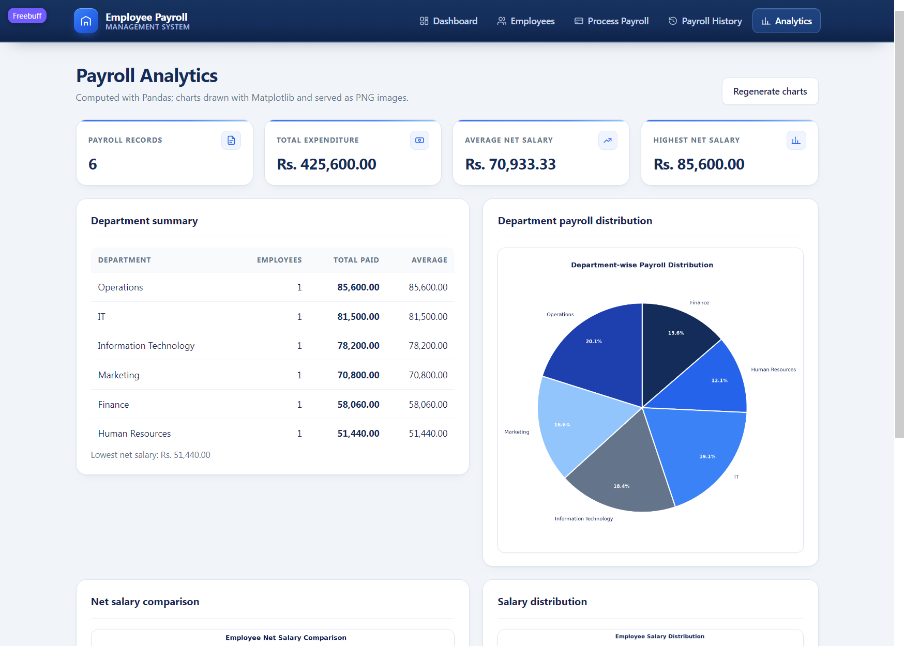

# Employee Payroll Management System

An academic mini-project that manages employee records, processes monthly payroll,
generates payslips and visualises salary analytics. It is implemented in **Python**
with a **Flask** web interface, **Object-Oriented Programming**, **CSV file storage**,
**Pandas** for analysis and **Matplotlib** for charts.

The project also keeps a fully working **console (CLI) version** (`main.py`) that uses
exactly the same model, service and storage code as the website.

---

## Table of contents

1. [Project overview](#1-project-overview)
2. [Team members](#2-team-members)
3. [Objectives](#3-objectives)
4. [Main features](#4-main-features)
5. [Technology stack](#5-technology-stack)
6. [Architecture](#6-architecture)
7. [Folder structure](#7-folder-structure)
8. [Installation](#8-installation)
9. [Virtual environment setup](#9-virtual-environment-setup)
10. [Dependency installation](#10-dependency-installation)
11. [Run instructions](#11-run-instructions)
12. [Test instructions](#12-test-instructions)
13. [Data storage](#13-data-storage)
14. [Sample data and reset procedure](#14-sample-data-and-reset-procedure)
15. [Supabase PostgreSQL setup](#15-supabase-postgresql-setup)
16. [Screenshots](#16-screenshots)
17. [Limitations](#17-limitations)
18. [Future enhancements](#18-future-enhancements)

---

## 1. Project overview

Payroll work is repetitive and error-prone when it is done manually: salary components
have to be added together, statutory deductions subtracted, and a payslip produced for
every employee. The **Employee Payroll Management System** automates that process for a
small organisation.

The application stores employee master data (ID, name, department, designation, basic
salary) and payroll transactions (HRA, allowances, PF, professional tax, gross, total
deductions, net salary). From that data it produces:

- a dashboard with headcount, payroll totals and department payouts,
- an employee directory with search, add, edit and delete,
- a payroll processing screen with a live salary calculation,
- printable payslips,
- a complete payroll history,
- salary analytics with three charts generated by Matplotlib.

All amounts are calculated with Python's `decimal.Decimal`, so results are exact to the
paisa instead of suffering from floating-point rounding errors.

---

## 2. Team members

| Name | USN |
| --- | --- |
| Sheikh Huzaifa | 25BTRCP048 |
| Pradhyot Tiple | 25BTRCP037 |
| Akshat Tiwari | 25BTRCP002 |

Project type: Python mini project (third semester).

---

## 3. Objectives

1. Store and maintain employee master data in a simple, portable format.
2. Calculate gross salary, total deductions and net salary accurately for each employee.
3. Produce a clear payslip showing every earning and deduction.
4. Keep a permanent history of processed payroll transactions.
5. Analyse payroll data (totals, averages, department-wise payout) using Pandas.
6. Present that analysis visually using Matplotlib charts.
7. Demonstrate Object-Oriented Programming: classes, encapsulation, composition,
   properties and validation.
8. Provide both a web interface and a console interface over one shared core.
9. Validate all user input and fail gracefully instead of crashing.
10. Verify the behaviour with an automated test suite.

---

## 4. Main features

**Dashboard**
- Employee count, payroll transaction count, total net payout, average net salary.
- Recent payroll table with links to each payslip.
- Department payout bars and a list of employees whose payroll is still pending.
- A notice that clearly labels the bundled records as sample demonstration data.

**Employee management**
- Add an employee (ID, name, department, designation, basic salary).
- Search by ID, name, department or designation.
- Edit any field except the employee ID.
- Delete an employee, with a confirmation prompt.

**Payroll processing**
- Choose an employee and enter HRA, other allowances, PF and professional tax.
- Live salary preview calculated by the Python backend while typing.
- Payslip preview before anything is written to disk; the record is saved only after
  explicit confirmation.
- Printable payslip (`Print` button, print stylesheet included).

**Payroll history**
- Every saved transaction, newest first, with gross, deductions and net salary.
- Per-record payslip view and running totals.

**Analytics**
- Summary statistics (records, total expenditure, average, highest, lowest).
- Department summary table.
- Three Matplotlib charts: net salary comparison (bar), department payroll
  distribution (pie), salary distribution (histogram).
- Charts are regenerated automatically when `payroll.csv` changes.

**Console version** (`main.py`)
- The same ten operations through a numbered text menu.

---

## 5. Technology stack

| Layer | Technology | Version used |
| --- | --- | --- |
| Language | Python | 3.14.7 |
| Web framework | Flask | 3.1.3 |
| Templating | Jinja2 (via Flask) | 3.1.6 |
| WSGI server (dev) | Werkzeug | 3.1.9 |
| Data analysis | Pandas | 3.1.1 |
| Charts | Matplotlib | 3.11.2 |
| Numeric support | NumPy | 2.5.4 |
| Database (production) | Supabase PostgreSQL | 18.x |
| Query layer | SQLAlchemy (Core) + psycopg 3 | 2.1.8 / 3.3.9 |
| Storage (offline / import-export) | CSV files (`csv` module, standard library) | - |
| Money arithmetic | `decimal.Decimal` (standard library) | - |
| Testing | pytest | 9.2.0 |
| Front end | Hand-written HTML5 + CSS3, small vanilla JavaScript | - |

No JavaScript framework, no database server and no CDN assets are used, so the site also
works on a laptop with no internet connection.

---

## 6. Architecture

The project follows a layered structure. The web layer and the console layer are thin
front ends; all rules live in the model, service and storage layers.

```
Browser (HTML forms, one fetch call)
        |
        v
app.py  -- Flask routes ------------------------------------ web layer
        |        renders Jinja2 templates, handles flash messages,
        |        converts form strings into validated objects
        v
services/employee_service.py   services/payroll_service.py  -- business layer
        |        add / search / update / delete employees,
        |        parse amounts, build Payroll objects, summaries
        v
models/employee.py             models/payroll.py            -- domain layer
        |        Employee dataclass (validation in __post_init__)
        |        Payroll dataclass + properties for salary maths
        v
storage/backend.py  ->  database_store.py  |  csv_manager.py    -- persistence layer
        |        PostgreSQL (Supabase) through SQLAlchemy / psycopg,
        |        or local CSV files when the CSV backend is selected
        v
analytics/salary_analysis.py   analytics/charts.py          -- analytics layer
                 Pandas summaries, Matplotlib PNG charts

main.py  -- console front end using the same services (menu driven)
```

**Request flow for processing payroll**

1. The user submits the payroll form (`POST /payroll/new`).
2. Flask reads the form fields and asks `EmployeeService` for the employee object.
3. `PayrollService.parse_amount()` converts each string into a `Decimal` and rejects
   empty, non-numeric, infinite or negative values.
4. `Payroll.__post_init__` checks that deductions do not exceed the gross salary and
   computes nothing else; `gross_salary`, `total_deductions` and `net_salary` are
   computed properties.
5. The payslip template is rendered. Nothing is saved at this point.
6. Only `POST /payroll/save` calls `get_store().save_payroll()`, which inserts one row
   into the active backend (PostgreSQL, or `data/payroll.csv` in CSV mode).
7. The user is redirected to the payroll history page with a success message.

---

## 7. Folder structure

```
PYTHON MINI PROJECT/
├── app.py                     Flask application and all web routes
├── main.py                    Console (CLI) version of the same system
├── requirements.txt           Pinned Python dependencies
├── .env.example               Environment template (placeholders only)
├── README.md                  This document
│
├── models/
│   ├── employee.py            Employee dataclass + validation + display_details()
│   └── payroll.py             Payroll dataclass + salary properties + generate_payslip()
│
├── services/
│   ├── employee_service.py    Add / search / update / delete employees
│   └── payroll_service.py     Amount parsing, payroll building, history, summaries
│
├── storage/
│   ├── backend.py             Selects PostgreSQL or CSV (get_store)
│   ├── database.py            DATABASE_URL handling, engine factory
│   ├── database_store.py      PostgreSQL repository - all SQL lives here
│   ├── schema.py              SQLAlchemy table definitions
│   ├── migration.py           Safe, repeatable CSV -> database import
│   └── csv_manager.py         CSV backend (offline, import/export)
│
├── analytics/
│   ├── salary_analysis.py     Pandas summaries (overall + department-wise)
│   └── charts.py              Matplotlib charts (bar, pie, histogram)
│
├── migrations/
│   └── 001_init_schema.sql    Supabase schema: tables, keys, indexes, RLS
│
├── templates/                 Jinja2 templates
│   ├── base.html              Shared layout, navigation, flash messages
│   ├── index.html             Dashboard
│   ├── employees.html         Employee list + search
│   ├── employee_form.html     Add / edit employee form
│   ├── payroll_form.html      Payroll form + live calculation panel
│   ├── payslip.html           Payslip (preview and saved record)
│   ├── history.html           Payroll history
│   ├── analytics.html         Summary tables + charts
│   └── error.html             404 / 500 page
│
├── static/
│   └── css/style.css          Responsive stylesheet + print styles
│
├── scripts/
│   ├── reset_data.py          Restore the sample dataset or clear all records
│   ├── init_db.py             Apply / verify the database schema
│   ├── migrate_csv_to_supabase.py  Safe CSV -> PostgreSQL migration
│   └── export_db_to_csv.py    Export database contents back to CSV
│
├── data/
│   ├── employees.csv          Employee master data (created automatically)
│   ├── payroll.csv            Payroll transactions (created automatically)
│   └── DEMO_DATA.txt          Marker: the bundled sample dataset is in use
│
├── api/
│   └── index.py               Vercel serverless entry point (exports the Flask app)
│
├── vercel.json                Vercel build + routing configuration (no secrets)
│
├── charts/                    PNGs written by the console/CLI only (not by web requests)
│   ├── salary_comparison.png
│   ├── department_payroll.png
│   └── salary_distribution.png
│
├── docs/
│   ├── PROJECT_EXPLANATION.md Technical explanation (viva-ready)
│   ├── DEMONSTRATION.md       5-8 minute live demonstration script
│   ├── VIVA.md                60 viva questions with answers
│   ├── FINAL_REPORT.md        Consolidated implementation report
│   └── screenshots/           Screenshots used in this README
│
└── tests/
    ├── test_employee.py       Employee model validation
    ├── test_payroll.py        Salary calculations
    ├── test_csv.py            CSV persistence
    ├── test_web.py            Flask routes, payroll flow, JSON API, analytics
    ├── test_database.py       Repository, migration, history integrity (isolated)
    └── conftest.py            Keeps tests away from any real database
```

---

## 8. Installation

Requirements: **Python 3.10 or newer** (developed and tested on Python 3.14.7 on
Windows 11) and the project source folder. No database server, internet connection or
environment variables are required to run it.

```bash
# 1. Open a terminal in the project folder
cd "PYTHON MINI PROJECT"

# 2. Check the interpreter
python --version
```

---

## 9. Virtual environment setup

A virtual environment keeps this project's packages separate from the rest of the
system.

```bash
# Create it once (a .venv folder is created inside the project)
python -m venv .venv
```

Activate it:

```bash
# Windows - Command Prompt or PowerShell
.venv\Scripts\activate

# Windows - Git Bash
source .venv/Scripts/activate

# Linux / macOS
source .venv/bin/activate
```

The prompt now starts with `(.venv)`. To leave it later, run `deactivate`.

---

## 10. Dependency installation

With the virtual environment active:

```bash
python -m pip install -r requirements.txt
```

This installs Flask, Pandas, Matplotlib and pytest, plus their own dependencies, at the
exact pinned versions.

> **Note:** always run the application and the tests with the virtual environment
> activated. If `python` on your machine points to a system interpreter without these
> packages, you will see `ModuleNotFoundError: No module named 'flask'` (or
> `'matplotlib'`). Two shortcuts that avoid activation entirely:
> `.venv/Scripts/python.exe app.py` and `.venv/Scripts/python.exe -m pytest tests/ -v`.

---

## 11. Run instructions

### Web version (recommended for the demonstration)

```bash
python app.py
```

Expected terminal output:

```
Employee Payroll Management System
Open http://127.0.0.1:5000 in your browser.
Press CTRL+C to stop the server.

 * Serving Flask app 'app'
 * Debug mode: on
 * Running on http://127.0.0.1:5000
```

Open **http://127.0.0.1:5000** in a browser. Stop the server with `CTRL+C`.

The development server only listens on `127.0.0.1`, so the site is reachable from the
demonstration laptop itself and is not exposed to the network.

### Console version

```bash
python main.py
```

A numbered menu (1-10) provides the same operations in the terminal.

### Restore the sample dataset

```bash
python scripts/reset_data.py --demo    # sample employees + payroll records
python scripts/reset_data.py --empty   # delete all records, keep the CSV headers
```

`reset_data.py` only touches the CSV files. When the application runs on PostgreSQL those
files are not read at all: to start the database from the sample set, empty the tables and
re-run `python scripts/migrate_csv_to_supabase.py`.

---

## 12. Test instructions

With the virtual environment active, from the project root:

```bash
python -m pytest tests/ -v
```

Last verified result:

```
53 passed in 6.17s     # default run: CSV backend, SQLite for the database tests
```

The same suite also passes with `PAYROLL_TEST_DATABASE_URL` pointing at a real PostgreSQL
database (49 tests passed there before the four chart-rendering tests were added; those
four only exercise HTTP responses and are storage-independent).

| Test file | Tests | What is covered |
| --- | --- | --- |
| `tests/test_employee.py` | 3 | Employee creation, empty name rejected, negative salary rejected |
| `tests/test_payroll.py` | 5 | Gross salary, total deductions, net salary, negative allowance rejected, deductions above gross rejected |
| `tests/test_csv.py` | 5 | File initialisation, save/load employee, duplicate ID rejected, save/load payroll, replace employees |
| `tests/test_web.py` | 22 | Dashboard, add/search/edit/delete employee, duplicate and empty-name rejection, 404 page, payroll preview, preview-not-saved, payroll save, negative amount rejection, history, payslip page, JSON API (success + rejection), analytics page with in-memory charts, chart PNG response, unknown chart 404, placeholder when there is no data, placeholder when rendering fails |
| `tests/test_database.py` | 18 | Database CRUD, duplicate ID rejected, payroll save and history, history after employee edit and after delete, Decimal exactness, persistence after reconnect, connection errors, backend selection, migration import / repeatability / non-overwrite / invalid rows / dry run, Flask workflow on the database store |
| **Total** | **53** | |

The web and CSV tests write to temporary files (pytest `tmp_path`), so running the suite
never modifies `data/employees.csv` or `data/payroll.csv`.

The database tests run against a temporary SQLite file by default. To run them against
PostgreSQL, create a **separate** test database and set `PAYROLL_TEST_DATABASE_URL`; the
suite truncates only that database. `tests/conftest.py` removes any `DATABASE_URL` from the
environment unless that variable is set, so a test run can never write to Supabase.

---

## 13. Data storage

The application has two interchangeable storage backends:

- **Supabase PostgreSQL** - the persistent production database
  (`employees`, `payroll_records` tables). See
  [section 15](#15-supabase-postgresql-setup) and
  [`docs/SUPABASE_INTEGRATION.md`](docs/SUPABASE_INTEGRATION.md),
- **CSV files** - the offline/demo backend, and the format used for import and export.

The sections below describe the CSV backend, which is still fully supported.

All CSV data lives in two plain files inside `data/`.

**`data/employees.csv`** - one row per employee:

```csv
emp_id,name,department,designation,basic_salary
EMP001,Aditya Sharma,Information Technology,Senior Software Developer,55000
```

**`data/payroll.csv`** - one row per processed payroll transaction. Each row stores a
snapshot of the employee details at the time of processing:

```csv
emp_id,name,department,basic_salary,hra,other_allowances,pf_deduction,professional_tax,gross_salary,total_deductions,net_salary
EMP001,Aditya Sharma,Information Technology,55000,22000,8000,6600,200,85000,6800,78200
```

**How the files are managed** (`storage/csv_manager.py`)

- `initialize_files()` creates `data/` and both files with their header row if they do
  not exist. It is called on application start, so a fresh clone works immediately.
- Reading uses `csv.DictReader`, so every row becomes a dictionary keyed by column name.
- Appending an employee or a payroll record opens the file in append mode and writes one
  row - existing records are never rewritten.
- Updating or deleting an employee loads all rows, replaces the list in memory and
  rewrites the file once (`replace_employees`).
- Files are opened with `newline=""` and `encoding="utf-8"` so Windows line endings and
  non-ASCII names are handled correctly.
- A duplicate `emp_id` is rejected by checking the file before appending.

**Deleting an employee does not delete payroll history.** Payroll rows are financial
records and already contain the employee name, department and basic salary, so they stay
intact and remain viewable from Payroll History.

---

## 14. Sample data and reset procedure

The repository ships with a fictional demonstration dataset:

| Employee ID | Name | Department | Basic salary |
| --- | --- | --- | --- |
| EMP001 | Aditya Sharma | Information Technology | 55,000 |
| EMP002 | Priya Nair | Human Resources | 38,000 |
| EMP003 | Rohan Mehta | Finance | 42,000 |
| EMP004 | Sara Fernandes | Marketing | 50,000 |
| EMP005 | Vikram Rao | Operations | 60,000 |
| EMP006 | Neha Kulkarni | Information Technology | 32,000 |

Five payroll transactions are included (EMP006 is deliberately left unprocessed so the
"Employees waiting for payroll" panel is visible). All names and amounts are invented and
exist only to demonstrate the software.

The dataset is clearly identified in three ways:

1. the dashboard shows a **"Sample demonstration data"** notice,
2. `data/DEMO_DATA.txt` marks the current files as sample data and explains how to reset,
3. this section of the README describes the records.

**Before a demonstration** run:

```bash
python scripts/reset_data.py --demo
```

That restores the six employees and five payroll records, removes any records added
during practice, and re-creates the marker file. To show the system starting from
scratch instead, run `python scripts/reset_data.py --empty`.

---

## 15. Supabase PostgreSQL setup

The application can keep all records in **Supabase PostgreSQL** instead of CSV files. The
interface, templates and payroll rules are identical in both modes; only the storage backend
changes. Full details: [`docs/SUPABASE_INTEGRATION.md`](docs/SUPABASE_INTEGRATION.md).

**1. Create the tables** - run `migrations/001_init_schema.sql` in the Supabase SQL editor,
or from a terminal with `DATABASE_URL` set:

```bash
python scripts/init_db.py
```

**2. Configure the connection** - copy `.env.example` to `.env` and fill in your own values.
Never commit `.env`:

```dotenv
PAYROLL_STORAGE=database
DATABASE_URL=postgresql://postgres.<project-ref>:<password>@aws-0-<region>.pooler.supabase.com:6543/postgres?sslmode=require
```

Use the transaction pooler (port 6543) for serverless hosts such as Vercel; the engine uses
`NullPool`, so no connection is held between requests.

**3. Import the existing CSV data** - backs up `data/` first, skips duplicates and never
overwrites existing rows:

```bash
python scripts/migrate_csv_to_supabase.py --dry-run
python scripts/migrate_csv_to_supabase.py
```

**4. Run the application** - `python app.py` now reads and writes PostgreSQL.

**5. Export or go back to CSV** - `python scripts/export_db_to_csv.py` writes the database
back out as CSV; setting `PAYROLL_STORAGE=csv` (or removing `DATABASE_URL`) returns to the
local files.

Backend selection: `PAYROLL_STORAGE=database` forces PostgreSQL, `csv` forces CSV, and when
the variable is absent PostgreSQL is used as soon as `DATABASE_URL` is set. If the database
is unreachable the site shows a 503 "Database unavailable" page instead of a stack trace.

### Deploying to Vercel

The repository already contains the serverless wiring:

- `api/index.py` imports the Flask app and exposes it as a WSGI callable.
- `vercel.json` builds that entry point and routes every request to it.

Requests never write to the filesystem: charts are rendered in memory and streamed from
`/charts/<filename>`, and the database is reached through the pooler with a `NullPool`
engine, so no connection is held between requests. Templates and static files ship inside
the function bundle.

Set `DATABASE_URL` in the Vercel project settings (Environment Variables). No anon or
service-role key is used anywhere: the browser only ever receives HTML, CSS, JS and PNGs.

> **Security - read before publishing.** The application has **no login**. Anyone who
> knows the URL can view, edit and delete employee and payroll records, and can generate
> payslips. Deploy it only with fictional demonstration data. Adding authentication is a
> separate, approved change; it is deliberately not included here.

---

## 16. Screenshots

Captured from the running application on 15 November 2026.

**Dashboard** - headcount, payroll totals, recent transactions and department payouts.



**Employees** - directory with live search and per-row actions.



**Process Payroll** - salary components on the left, live calculation by the Python
backend on the right.



**Payslip** - earnings, deductions and net salary, ready to print.



**Payroll History** - every saved transaction with a link to its payslip.



**Analytics** - Pandas summary tables and Matplotlib charts.



**Narrow screen** - the same employee list at 430 px wide; the navigation wraps and wide
tables scroll horizontally.


---

## 17. Limitations

1. **No authentication or user accounts.** Anyone who can open the address can use the
   system. It is intended for a single user on one laptop.
2. **Single-user file storage.** CSV files have no locking; two people saving at the same
   moment could overwrite each other's changes. Not tested for concurrent use.
3. **No pay period column.** Payroll records are stored as a sequential ledger without a
   month or date field, so two payroll runs for the same employee look identical in the
   history.
4. **No PDF or emailed payslips.** The payslip is an HTML page that can be printed with
   the browser (including "Save as PDF").
5. **Amounts are entered manually.** HRA, PF and tax are not derived from salary
   percentages; the clerk types them. (Allowing percentage rules would be a natural
   extension.)
6. **The development server is used locally.** `app.py` runs Flask's built-in Werkzeug
   server, with the debugger on unless `PAYROLL_DEBUG=0` is set. It is not a production
   server and must not be exposed to a network; on Vercel the app is served as a WSGI
   callable and `app.run()` is never reached.
7. **No audit trail.** Editing an employee overwrites the stored values; there is no
   history of changes.
8. **Charts are static images.** Each chart is rendered on request and streamed from
   memory as a PNG; the charts are not interactive.
9. **Inheritance is not used.** OOP is demonstrated through classes, composition,
   properties, encapsulation and static services; there is no class hierarchy.
10. **No authentication.** Anyone who can reach the site can read, edit and delete every
    record. Supabase PostgreSQL storage is available (section 15), but CSV remains the
    default locally and neither mode is suitable for real payroll data.

---

## 18. Future enhancements

- Add a pay period (month/year) column and month-wise payroll reports.
- Convert storage to SQLite or PostgreSQL with proper transactions and indexing.
- Add login (Flask-Login) with roles for an administrator and a payroll clerk.
- Generate PDF payslips and email them automatically.
- Compute HRA, PF and tax from configurable salary rules.
- Add leave, attendance and overtime records, and prorate salary accordingly.
- Add exports (CSV / Excel) and a monthly salary register.
- Make the charts interactive (Plotly or Chart.js) with month and department filters.
- Add pagination and sorting for large employee lists.
- Deploy behind a production WSGI server (Gunicorn / Waitress) with HTTPS.

---

## Related documents

| Document | Contents |
| --- | --- |
| [`docs/PROJECT_EXPLANATION.md`](docs/PROJECT_EXPLANATION.md) | Why Python, how Flask, OOP and Decimal are used, validation, testing |
| [`docs/DEMONSTRATION.md`](docs/DEMONSTRATION.md) | 5-8 minute live demonstration script |
| [`docs/VIVA.md`](docs/VIVA.md) | 60 viva questions with answers |
| [`docs/FINAL_REPORT.md`](docs/FINAL_REPORT.md) | Consolidated implementation report and final status |
